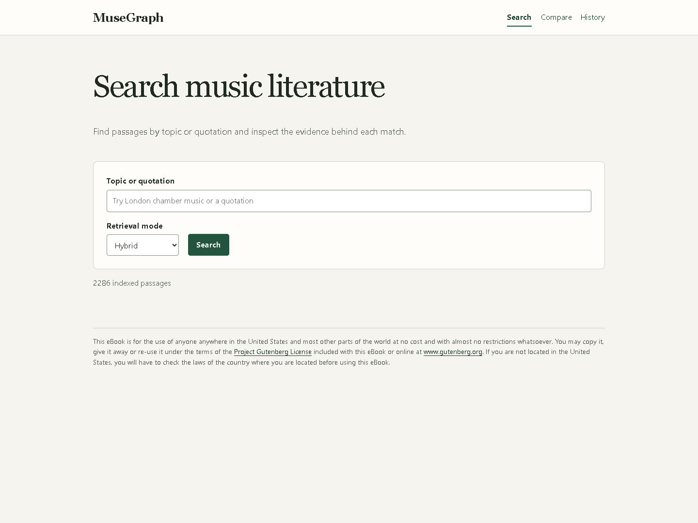
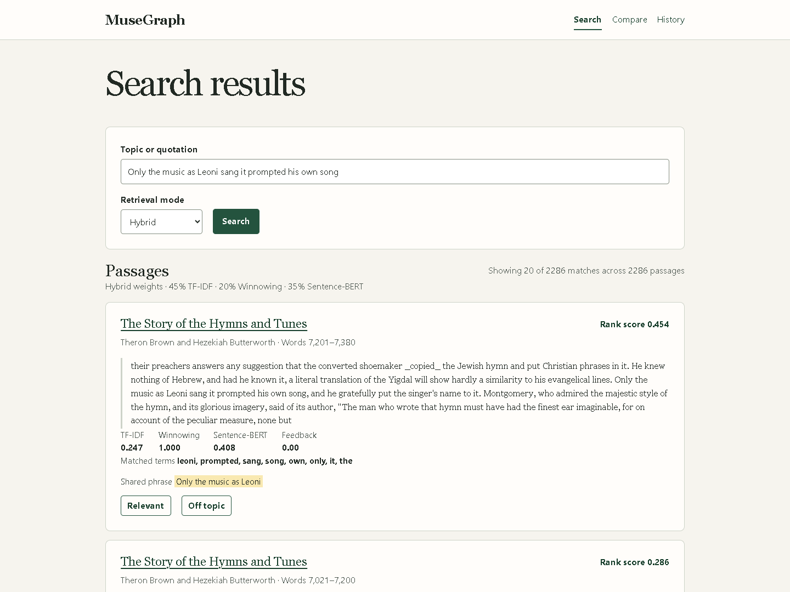
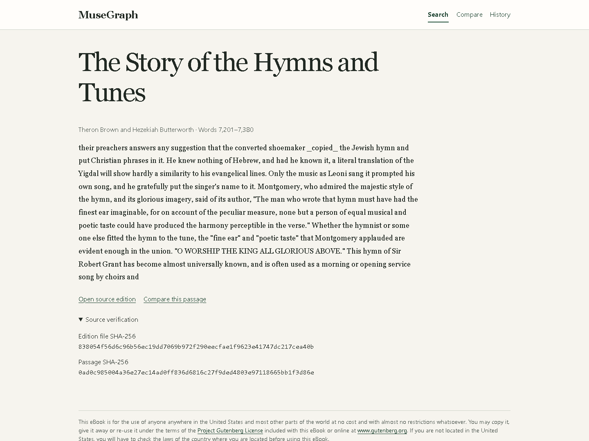
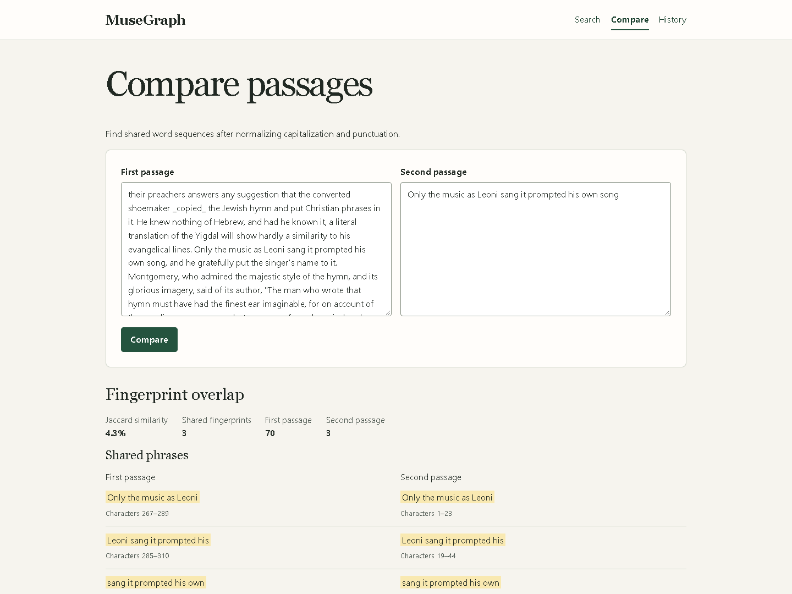
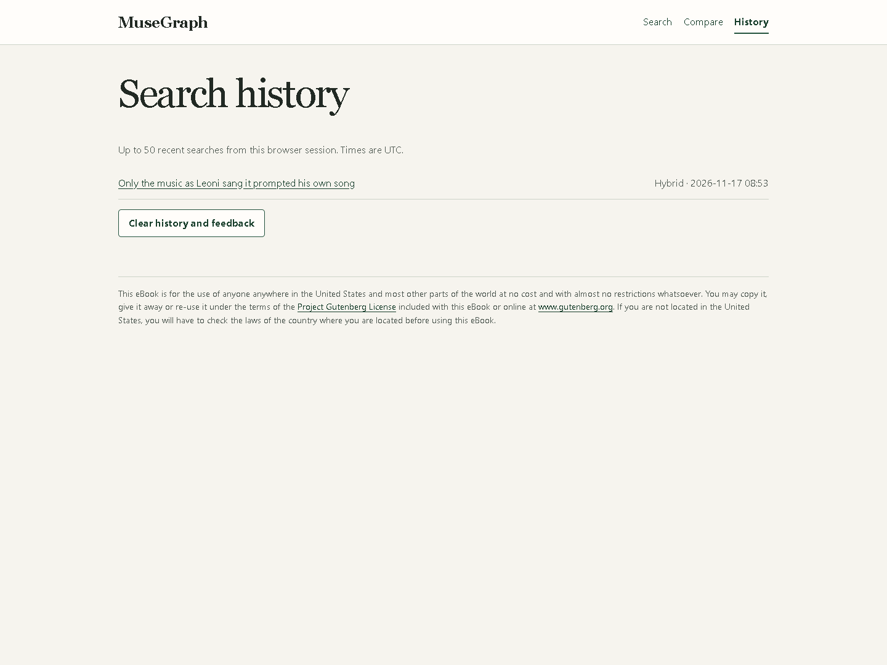

# MuseGraph walkthrough

**Mao Wen**

I use benchmark query `R08` to show how I can locate a remembered quotation, inspect the result, and check the wording against the source. The browser walkthrough runs against the bundled corpus of 2,286 passages from five Project Gutenberg books. [Watch the MP4](demo/musegraph_demo.mp4) · [Read the error analysis](ERROR_ANALYSIS.md#r08--the-leoni-quotation)

## Search the collection

I open the search page and check that the passage count is 2,286.



I select Hybrid and search for **Only the music as Leoni sang it prompted his own song**. The first result shows the TF-IDF, Winnowing, and Sentence-BERT scores and a shared phrase. I mark it **Relevant** and the recording shows the resulting +0.15 adjustment.



## Verify the match

I open `pg18444-0041` from *The Story of the Hymns and Tunes*. Under **Source verification**, I can see the SHA-256 digests for the edition file and the passage. The page also retains the word range and the link to the Gutenberg edition.



I send the passage to **Compare** and enter the remembered quotation in the second field. The comparison reports the Jaccard overlap and highlights the matching spans in both inputs.



I return to **History** to reopen the search from the same browser session.



## Regenerate the media

I use a temporary SQLite database and warm the semantic index before opening the recording browser. The script captures five PNGs and encodes the browser recording as a silent H.264 MP4.

```bash
python -m pip install -e ".[semantic,demo]"
python -m playwright install chromium
python scripts/make_demo_video.py
```

With Microsoft Edge installed, run `python -m playwright install ffmpeg` and use `python scripts/make_demo_video.py --browser-channel msedge`. For Chrome, use `--browser-channel chrome`. Set `MUSEGRAPH_SEMANTIC_MODEL` to a compatible local model directory to use local weights. Pass `--output` to save the recording outside `demo/`. To refresh existing media, generate all six files in a fresh output directory. If publication is interrupted, use the complete prior set or rerun into a fresh directory before publishing the new set. [Recording script](scripts/make_demo_video.py)
