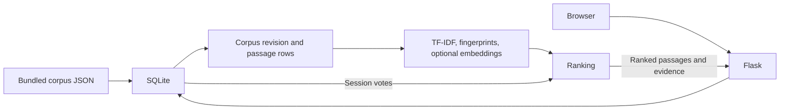

# Design notes

**Mao Wen**

I treat a search result as an entry point into a source edition. The application carries the passage ID from search to the source page and comparison form, so a reader can check the match without copying the text into a separate tool.

## Storage and index lifetime

I import the bundled collection when Flask initializes an empty database. The startup migration identifies retired records from version 1.0 by exact row hashes and keeps unrelated imports. The CLI validates imported data before writing. The replace option clears the current passages and their associated votes. An upsert with identical values leaves the corpus revision intact.

SQLite triggers advance the corpus revision when passage rows change. I read the rows and revision in one transaction, then build the in-memory index from the resulting snapshot. Each application instance holds its own index. A cache lock serializes sparse rebuilds and a separate index lock serializes its first dense build when semantic retrieval is enabled. A warm search reads the revision and, when there is a session ID, loads votes with one query. A cache miss adds one bulk document read. Votes are read before the corpus snapshot transaction. [Startup import](musegraph/initialization.py) · [Schema](musegraph/schema.sql) · [Index cache](musegraph/ranking.py)

The history index follows the session filter and displayed sort order. A separate index on the feedback document ID supports SQLite's cascading deletes. The existing compound primary key serves session-and-query vote lookups.

## Browser workflow

| Endpoint | Role |
| --- | --- |
| `GET /` | Show the search form and indexed passage count |
| `POST /search`, `GET /search` | Record a submission, redirect, and render ranked passages |
| `GET /document/<id>` | Open the text, edition link, word range, and SHA-256 digests |
| `GET /compare`, `POST /compare` | Prefill or compare two passages and show verified shared spans |
| `POST /feedback` | Set or clear a vote for the passage and normalized query |
| `GET /history`, `POST /history/clear` | Show up to 50 recent entries or clear the session’s history and votes |
| `GET /corpus-license` | Serve the bundled Project Gutenberg license |

I store a session ID and form token in a signed cookie. SQLite holds the history and votes associated with that ID. History keeps the latest submission for each normalized query and mode. Votes follow the normalized query across modes and apply only within the current session. The 50-entry limit applies to the history view. SQLite retains history and votes until the browser explicitly clears them or the database is maintained. Opening a results URL exposes the query to browser history and to access logs configured to record query strings.

## Local configuration

I use the `MUSEGRAPH_` environment prefix. Set `MUSEGRAPH_DATABASE` to select a different SQLite file. By default the application uses `musegraph.sqlite3` in Flask’s instance directory. Set `MUSEGRAPH_SEMANTIC=true` to enable dense retrieval. When a signing key is absent, the application generates and retains one in SQLite. Set `MUSEGRAPH_SESSION_COOKIE_SECURE=true` if serving over HTTPS.

I chose direct scoring over the in-memory collection so each mode can expose its component scores and evidence using the same corpus snapshot. Larger collections would increase the cost of a cold build and a full scan. [Algorithm costs](TECHNICAL_REPORT.md#algorithm-costs) · [Measured timings](RESULTS.md#timing)
