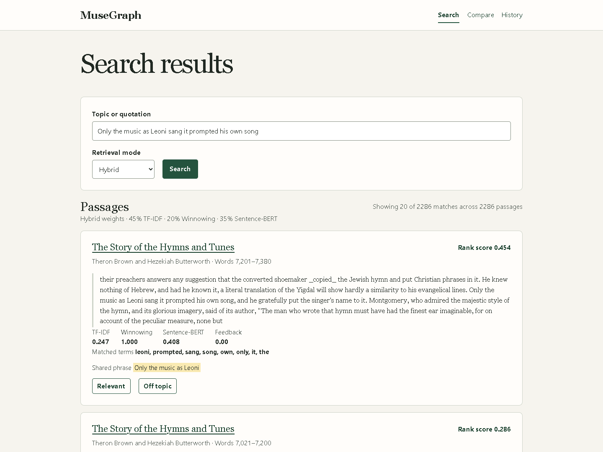
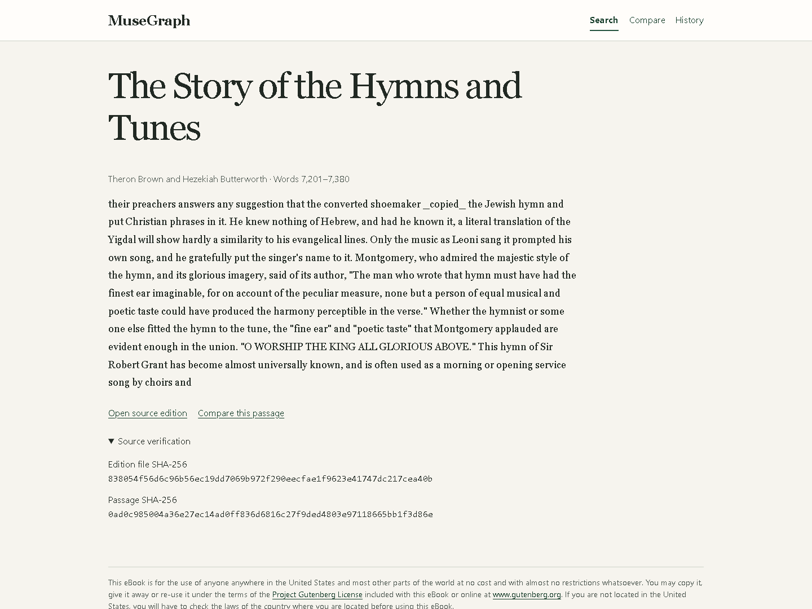

# MuseGraph

## Overview

MuseGraph helps readers recover passages from historical music literature through custom TF-IDF and Winnowing implementations and a pinned pretrained Sentence-BERT model, with match evidence visible in the interface.

[](demo/musegraph_demo.mp4)

In this example, the shared phrase helps the reader check a remembered quotation before opening the source edition.

[Watch the local MP4 walkthrough](demo/musegraph_demo.mp4) · [View all screenshots](DEMO.md)

## Background and motivation

I studied piano performance at Nanjing University of the Arts. When reading about a composition, performer, or musical institution, I often return to a source with incomplete information: a few remembered words, a person’s name, or a paraphrased idea. A keyword search works well for exact terms but can miss a paraphrase. A semantic model can find related material but may rank a neighboring passage above the exact quotation.

I designed MuseGraph to keep these signals separate and inspectable. The interface exposes weighted terms, shared word fingerprints, the strongest semantic window, and the original source passage. This lets a reader check why a passage ranked highly before using it in further research.

## Research objectives

I use the project to answer four engineering questions:

1. How can lexical, fingerprint, and semantic retrieval operate over the same traceable passage collection?
2. What evidence can the interface expose for each type of match?
3. How do the retrieval modes behave on term, paraphrase, and quotation queries?
4. How can a local application preserve source provenance while remaining reproducible from a cloned repository?

## Key features

- TF-IDF retrieval with the highest-contributing shared terms.
- Winnowing fingerprints over normalized five-word sequences, with verified source spans.
- Optional Sentence-BERT retrieval over overlapping passage windows.
- Hybrid ranking with visible component scores.
- Side-by-side passage comparison using fingerprint Jaccard similarity.
- Edition URLs, word ranges, and SHA-256 digests for every bundled passage.
- Query history and explicit Relevant or Off topic feedback within a browser session.
- Command-line evaluation with Precision@K, Recall@K, nDCG@K, latency, and per-query errors.

## Methodology

### Lexical retrieval

I tokenize titles, authors, and passage bodies with Unicode normalization and case folding. Term frequency uses logarithmic scaling, inverse document frequency is smoothed, and L2 normalization turns the vector dot product into cosine similarity. Result cards display up to eight shared terms ordered by their contribution to the score.

### Winnowing fingerprints

I hash consecutive five-word tuples with 64-bit BLAKE2b and select the rightmost minimum from each window of four hashes. The implementation verifies matches with the normalized tuple itself and retains original character offsets. Search measures the fraction of query fingerprints found in a passage. The Compare page uses Jaccard similarity over the two fingerprint sets.

### Semantic retrieval

The optional semantic index uses the pinned `sentence-transformers/all-MiniLM-L6-v2` checkpoint. Passage bodies are divided into overlapping windows of at most 128 model tokens. I score each passage by its highest window cosine and return that original window as evidence.

### Hybrid ranking and feedback

Hybrid combines TF-IDF, Winnowing, and semantic scores with weights of 0.45, 0.20, and 0.35. When semantic retrieval is disabled, the two available weights are renormalized. Session feedback adds or subtracts 0.15 from the base score for the same normalized query and passage.

The detailed formulas, complexity discussion, and implementation links are in [docs/methodology.md](docs/methodology.md).

## Technology stack

| Area | Technology |
| --- | --- |
| Application | Python 3.11+, Flask, Jinja, SQLite |
| Lexical retrieval | Custom TF-IDF implementation |
| Text fingerprints | Custom Winnowing implementation with BLAKE2b |
| Semantic retrieval | Sentence Transformers and PyTorch |
| Evaluation | Custom Precision@K, Recall@K, and nDCG@K implementation |
| Testing | pytest |
| Demo capture | Playwright and imageio-ffmpeg |

## Repository structure

```text
musegraph-retrieval-system/
├── data/                       # Bundled corpus, judgments, reports, and source license
├── demo/                       # Five screenshots and the local MP4 walkthrough
├── docs/                       # Methodology, experiment, and reproducibility notes
├── musegraph/                  # Flask application and retrieval implementation
│   ├── algorithms/             # Text normalization, TF-IDF, and Winnowing
│   ├── static/                 # Application CSS
│   └── templates/              # Jinja templates
├── scripts/                    # Corpus builder, error analysis, and demo recorder
├── tests/                      # Algorithm, application, repository, and CLI tests
├── LICENSE
├── pyproject.toml
├── requirements.txt
└── README.md
```

## Dataset description

The committed corpus contains 2,286 successive passages from five Project Gutenberg editions. Each passage contains 180 whitespace-delimited words except for the shorter final passage of a book. Contents pages and indexes inside the edition markers remain searchable. The builder includes every block produced from the text between the edition markers.

| Gutenberg edition | Work | Author | Passages |
| --- | --- | --- | ---: |
| [5724](https://www.gutenberg.org/ebooks/5724) | *A Book of Operas* | Henry Edward Krehbiel | 463 |
| [17474](https://www.gutenberg.org/ebooks/17474) | *How to Listen to Music, 7th ed.* | Henry Edward Krehbiel | 345 |
| [18444](https://www.gutenberg.org/ebooks/18444) | *The Story of the Hymns and Tunes* | Theron Brown and Hezekiah Butterworth | 681 |
| [28056](https://www.gutenberg.org/ebooks/28056) | *Music and Some Highly Musical People* | James Monroe Trotter | 555 |
| [70203](https://www.gutenberg.org/ebooks/70203) | *The Story of Chamber Music* | Nicholas Kilburn | 242 |

The application does not collect research participants’ data. Search history and feedback stay in the local SQLite database and are associated with an opaque browser-session identifier. The texts are distributed with the Project Gutenberg license included in the repository. Users outside the United States should check the copyright status applicable to their location. Exact edition hashes, passage counts, and rebuilding instructions are documented in [data/README.md](data/README.md).

## Installation

Clone the repository, then create an isolated environment in PowerShell:

```powershell
py -3.11 -m venv .venv
.\.venv\Scripts\Activate.ps1
python -m pip install --upgrade pip
python -m pip install -e .
```

This installs the lexical and fingerprint application. For Sentence-BERT, tests, evaluation, and demo generation, install the verified direct dependencies:

```powershell
python -m pip install -r requirements.txt
python -m pip install -e . --no-deps
```

The exact direct versions in `requirements.txt` are the versions used for the final verification. The compatibility ranges used by the package remain in `pyproject.toml`.

## Usage

Start the default lexical and fingerprint application:

```powershell
python -m musegraph run
```

Open <http://127.0.0.1:5000/>. The first launch imports the committed corpus without a network request. To enable semantic retrieval:

```powershell
$env:MUSEGRAPH_SEMANTIC = "true"
python -m musegraph run
```

The first semantic search loads the model and builds the dense index. It may download the pinned checkpoint if it is not cached. A compatible local checkpoint can be supplied with `MUSEGRAPH_SEMANTIC_MODEL`.

Useful CLI commands include:

```powershell
python -m musegraph init-db
python -m musegraph corpus-info
python -m musegraph evaluate --semantic --k 5
python -m scripts.analyze_errors --semantic --k 5
```

## Experimental setup

I evaluated four modes on the same corpus and ten graded queries at rank five. This is a single-annotator pilot benchmark rather than a population-level estimate of retrieval quality. The set contains three term queries, three paraphrases, and four quotations. Feedback was disabled. Term and paraphrase judgments cover a pool of candidate passages. Quotation positives contain the full normalized query sequence. Unjudged passages contribute zero gain, so Recall@5 measures recovery of the known positives in the judgment file.

The final two runs used Windows, Python 3.13.17, Sentence Transformers 5.7.0, PyTorch 2.15.0+cpu, four OpenMP threads, and the pinned MiniLM revision `c9745ed1d9f207416be6d2e6f8de32d1f16199bf`. [docs/experiments.md](docs/experiments.md) defines the metrics and timing boundaries.

## Results and visualizations

With feedback disabled, Hybrid reached a macro nDCG@5 of 0.8949 versus 0.8417 for TF-IDF across ten queries graded by a single annotator. Recall@5 measures recovery of known relevant passages, with pooled judgments for term and paraphrase queries.

| Mode | Precision@5 | Recall@5 | nDCG@5 |
| --- | ---: | ---: | ---: |
| TF-IDF | 0.5000 | 0.7456 | 0.8417 |
| Winnowing | 0.0800 | 0.4000 | 0.4000 |
| Sentence-BERT | 0.4000 | 0.4011 | 0.4209 |
| **Hybrid with Sentence-BERT** | **0.5800** | **0.8125** | **0.8949** |

The Hybrid median was 56.39 ms in `evaluate` and 58.06 ms in `analyze_errors.py` after index construction. End-to-end times, including dense setup, were 324.08 s and 254.11 s. The two commands produced the same rankings and quality metrics with the same evaluator and inputs. The timings come from separate runs of that shared pipeline.



[RESULTS.md](RESULTS.md) contains the complete timing table. [ERROR_ANALYSIS.md](ERROR_ANALYSIS.md) examines three query-level cases, including a quotation where Winnowing locates the exact wording and Sentence-BERT favors an adjacent passage.

## Limitations

- The ten-query judgment set is small and was created for this collection. It does not establish performance on other corpora.
- Recall for term and paraphrase queries is relative to pooled known positives, rather than exhaustive relevance judgments over all 2,286 passages.
- The Hybrid weights and feedback adjustment are fixed manually. They were not learned on a held-out set.
- Indexes are held in memory, and each search scores the full passage collection. Larger collections would need persistent sparse and vector indexes.
- Sentence-BERT setup dominates cold-start time on CPU and requires model weights beyond the cloned repository.
- Fixed 180-word boundaries can split an argument across adjacent passages.

## Future improvements

- Extend the query set and obtain independent graded judgments before tuning ranking weights.
- Compare passage segmentation based on paragraphs or sections with the current fixed-word segmentation.
- Add persistent embedding storage and an approximate nearest-neighbor index for larger collections.
- Evaluate learned or query-dependent fusion on separate training and test queries.
- Add exportable citations and richer source-context navigation around neighboring passages.

## References

- Schleimer, S., Wilkerson, D. S., and Aiken, A. “Winnowing: Local Algorithms for Document Fingerprinting.” SIGMOD 2003. [Paper](https://sschleimer.warwick.ac.uk/Maths/winnowing.pdf)
- Reimers, N., and Gurevych, I. “Sentence-BERT: Sentence Embeddings using Siamese BERT-Networks.” EMNLP-IJCNLP 2019. [ACL Anthology](https://aclanthology.org/D19-1410/)
- Sentence Transformers. `all-MiniLM-L6-v2`. [Pinned model revision](https://huggingface.co/sentence-transformers/all-MiniLM-L6-v2/tree/c9745ed1d9f207416be6d2e6f8de32d1f16199bf)
- Project Gutenberg. [Project Gutenberg](https://www.gutenberg.org/)

## License

I release the application code under the [MIT License](LICENSE). The bundled editions retain the [Project Gutenberg License](data/GUTENBERG_LICENSE.txt).
